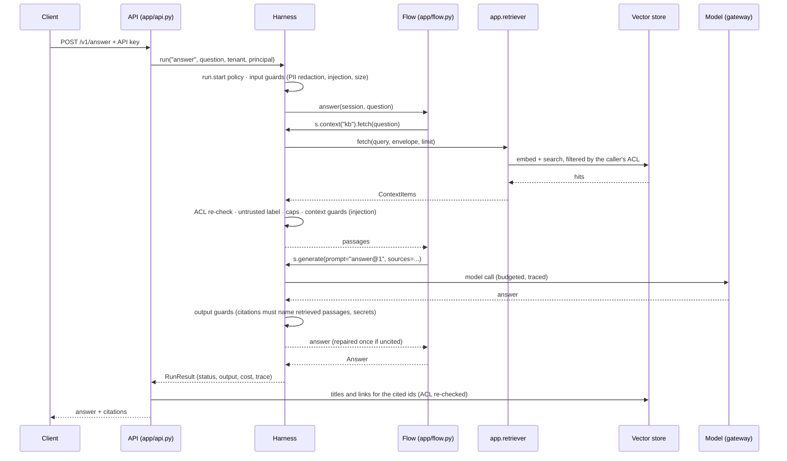
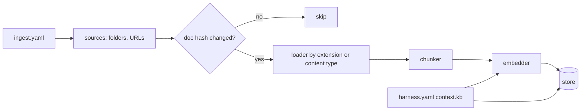

# Architecture

The template is two pipelines that share one configuration block: ingestion writes chunks into a
vector store, and the `answer` task reads them back. HarnessWeaver governs the second one end to
end.

## A question, step by step

What each layer owns:

| Layer | Owns | Doesn't |
|---|---|---|
| `harness.yaml` | Every control, every model alias, the retrieval settings | Code |
| HarnessWeaver | Guards, ACL re-checks, budgets, policy, repairs, idempotency, traces, evals | Retrieval, storage, serving |
| `app.retriever` | Embedding the query, searching, reranking, the ACL pre-filter | Model calls (those go through the session) |
| `app/flow.py` | The steps: fetch, then generate | Any control: it never checks or catches anything itself |
| `app/api.py` | HTTP, auth, status codes, citation metadata | Business logic |

## Ingestion

A document's hash covers its bytes, its ACL and metadata, the chunking settings and the embedder,
so changing any of them re-indexes it on the next run. Every chunk records the embedder that
produced it, and retrieval refuses an index built with another one rather than returning
nonsense.

## Design decisions

**One configuration block.** The retriever's settings are the extra keys of `context.kb`, which
HarnessWeaver validates against `RetrieverConfig` when the harness loads, and overlays merge key
by key. Ingestion builds its store and embedder from the same block with
`Retriever.from_spec(hw.load_spec(...))`, so the two can't drift apart. The config models are flat,
so an overlay that switches `kind: qdrant` to `kind: memory` doesn't trip over the Qdrant `url`
left over from the base spec.

**Model calls go through the session; retrieval doesn't.** Embedding and search happen inside
the provider. Anything that calls the chat model uses `s.generate`, so it is budgeted, traced and
guarded.

**Why `Answer` has one field.** HarnessWeaver checks a session's final output again at
`output.before` unless it is exactly the value a guard already accepted. It checks every string
in it separately, and `grounded.citations` asks to repair any string of four or more words that
cites nothing. At the end of a run nothing is left to repair, so the run would end blocked.
So the output carries only the cited answer, or `None` when nothing was found (and the model's
`NOT_FOUND`, a word too short to need a citation). Titles and links are looked up by chunk id
outside the run, with the ACL checked again. If you add string fields to `Answer`, make them
cite their sources or keep them out of the run's output.

**"Not found" is normalized before it is checked.** Models often wrap the not-found reply in a
sentence ("The sources don't mention that. NOT_FOUND"), which the citation guard would send back
for repair. The `not-found` guard on the task, a `regex.deny` with `action: redact`, runs first
and reduces any reply containing `NOT_FOUND` to exactly that word. Guards on `output.before` run
in list order and each sees the previous one's redaction, so keep it before `citations`.

**Chunk ids are citations.** A chunk's id is `<source name>/<path>#<n>`, built only from
characters the citation pattern accepts, so the model can cite `[public/refunds.md#0]` verbatim
and a person can read it.

**Every guard on the task sees every model call.** Task guards run at `output.before`, which
every `s.generate` fires. A second model call in the `answer` task, such as rewriting a
follow-up question, would therefore be asked to cite sources too. Give such a step its own task
(see [extending.md](extending.md)).

**Streaming and repairs.** Chunks reach the client as the model produces them, and the citation
check runs on the full answer. When it asks for a repair, the second answer streams after the
first, so the API sends `reset` between them (the trace's `repair` event) and ends with an
authoritative `result`.

**Defense in depth for tenants.** Stores filter by ACL in the query (Qdrant payload filters,
SQL in pgvector), HarnessWeaver drops anything a provider returns that the caller may not see, and
the API re-checks before showing a citation's title. A `run.start` policy rule stops anonymous
callers from naming a tenant.

## Offline by design

`HARNESSWEAVER_ENV=offline` swaps the model for HarnessWeaver's scripted model, the embedder for
`hashing` and the store for `memory`. Tests also set `HARNESSWEAVER_TEST_MODE=1`, so every live
provider (the OpenAI-compatible embedder, the reranker, Qdrant and Postgres clients) refuses the
network. A test can't call a paid API by accident.
